# File Organizer

**Deterministic, offline, explainable file organization.** 


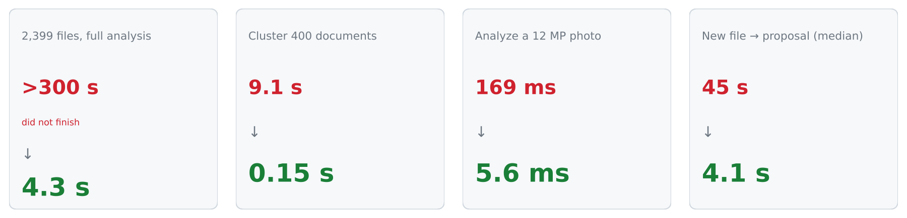

---

## Contents

- [Why this project](#why-this-project)
- [Highlights](#highlights)
- [Quick start](#quick-start)
- [Demo](#demo)
- [How it works](#how-it-works)
- [Safety model](#safety-model)
- [Background service and dashboard](#background-service-and-dashboard)
- [Benchmarks](#benchmarks)
- [Accuracy evaluation](#accuracy-evaluation)
- [Repository layout](#repository-layout)
- [Testing](#testing)
- [Known limitations](#known-limitations)
- [Roadmap](#roadmap)
- [Contributing](#contributing) · [License](#license) · [Documentation](#documentation)

---

## Why this project

Download folders fill up with names like `IMG_0412.jpg`, `a1b2c3d4e5f6a7b8.pdf` and `tmp_8f3a9c1d2e.png`. Tools that rename files with machine-learning models raise real concerns: your documents leave the machine or need large local models, results can change between runs, and the reasoning is opaque.

This project explores the opposite design point: **how far can classical, deterministic algorithms go?** The answer is a pipeline built from well-understood parts (magic-byte sniffing, partial and full hashing, TF-IDF with bigrams, perceptual hashing, container parsing, average-linkage clustering) where the same folder always produces the same result, and where every number can be traced to a formula.

The design goals, in priority order:

1. **Never harm the user's data.** Nothing is deleted or overwritten; low-confidence files are set aside with their names untouched; every change is reversible.
2. **Explain everything.** Each decision stores its signals, confidence and reason, including why a file was *left alone*.
3. **Be predictable.** Deterministic output, auditable formulas, no learned weights.
4. **Be fast enough to forget about.** Thousands of files in a few seconds on one core, and new files noticed within seconds.

## Highlights

- **Five-stage engine**: crawl, inspect, extract features, group and score, decide, with one folder in and one reviewable *manifest* out.
- **Real file-type detection** from magic bytes, not extensions. Hand-written parsers for **MP4/MOV atoms, ID3v1/v2 tags, MP3 frames, WAV chunks, PE version resources, ELF headers**, zip/tar listings and Office/OpenDocument text.
- **Explainable confidence** (0 to 1) from published formulas. Below the threshold a file is quarantined into `_Review_Needed/` with its original name.
- **Exact duplicate detection** that is cheap first (size, then a 128 KB partial hash) and certain last (full SHA-256 only for candidates).
- **Perceptual photo grouping** with a 64-bit dHash and a pigeonhole-accelerated Hamming search; screenshots and camera photos are told apart from colour statistics and EXIF.
- **Background monitoring** with a settle rule so half-downloaded files are never touched, ask-first or automatic modes, a live activity log, and a tray icon.
- **Preview, apply, rollback**: the dry run writes a manifest; `apply` executes exactly that manifest; `rollback` restores the folder byte for byte.
- **Local dashboard** (a single HTML file with no external requests) locked to `127.0.0.1` with token, Host-header and CSP protections.
- **96 automated tests**, including a property test that proves the optimized clustering equals the textbook algorithm.

## Quick start

Requirements: **Python 3.10+** on Windows, macOS or Linux.

```bash
git clone https://github.com/victor-oswald/file-organizer.git
cd file-organizer
pip install -r requirements.txt          # Pillow, pystray, pypdf

python -m organizer ui                   # dashboard + background monitoring
```

Or double-click the launcher for your system: `Start File Organizer.bat` (Windows), `start_file_organizer.command` (macOS), `start_file_organizer.sh` (Linux). On first run they install missing dependencies.

Command line, for scripting and for studying the engine:

```bash
python -m organizer preview  ~/Downloads --dupes move     # dry run: writes a manifest, changes nothing
python -m organizer apply    <manifest.json>              # execute exactly what was previewed
python -m organizer rollback <manifest.json>              # undo it
python -m organizer autostart enable                      # start when you sign in
```

### Platform support

| Platform | Status | Details |
|---|---|---|
| **Windows** | Verified | Verified end to end, including the system-tray icon, the dashboard, background monitoring, and runs on real files. |
| **Linux** | Automated tests(github actions) | The full test suite and real background-daemon runs on Linux. The tray needs a desktop with an AppIndicator-capable tray; where none exists the small control-window fallback is used (covered by unit tests only). |
| **macOS** | Implemented, **not yet verified** | The engine and dashboard are platform-neutral and covered by the test suite; the menu-bar icon and the LaunchAgent autostart are implemented but have not been exercised on a Mac. A 15-minute [verification checklist](docs/MACOS_VERIFICATION.md) is provided; reports are very welcome. |

## Demo

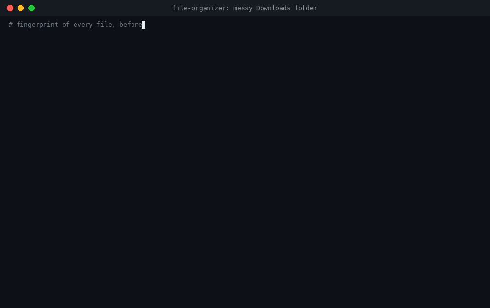

*A real session on a deliberately messy folder: camera photos with `IMG_` names, hash-named documents, a screenshot, MP3, WAV and MP4 files, a ZIP, an EXE, an exact duplicate and an unreadable binary. The recording script (`tools/make_demo_gif.py`) executes the commands and renders their actual output (long lines are cut to fit the frame and the temporary path is shown as `~/Downloads`). It also **asserts that the folder fingerprint after rollback equals the one before**, and refuses to write the file otherwise.*

What to notice:

| File | Result | Why |
|---|---|---|
| `IMG_0001.jpg` | `_Events/2024-05-03_1015/2024-05-03_101530_128x96.jpg` | EXIF capture date; four media files within 4 hours form an event |
| `a1b2c3d4e5f6a7b8.txt` | `2026-11-18_Document_Quarterly-Sales_Revenue-Growth.txt` | 96 % confidence from TF-IDF bigrams |
| `track01.mp3` | `The Band - Great Song.mp3` | ID3 artist and title |
| `Meeting notes.txt` | unchanged | the name is already clean, so it is preserved |
| `Meeting notes (copy).txt` | moved to `_Duplicates/` | byte-identical (SHA-256) to the original |
| `p3.jpg`, `copy1.bin` | `_Review_Needed/`, name untouched | confidence below 0.60, so the tool never guesses |

## How it works

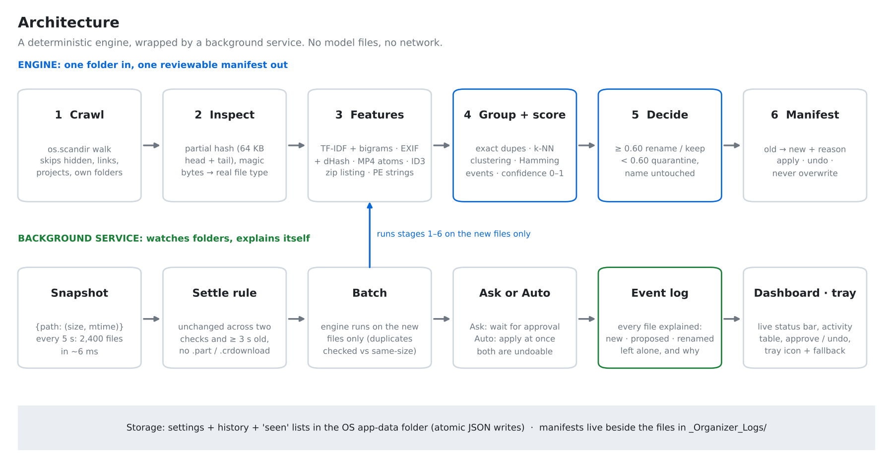

### The engine

| Stage | What happens | Key technique |
|---|---|---|
| **1. Crawl** | Walk the folder; skip hidden files, symlinks and junctions, software projects, and the program's own folders. Sorted for determinism. | `os.scandir`, in-place pruning |
| **2. Inspect** | Fingerprint each file and identify its *real* type. | Partial hash (size + first/last 64 KB), magic bytes, RIFF and ISO-BMFF sub-typing |
| **3. Features** | Extract type-specific facts. | Tokenizer with stop words, EXIF, dHash, MP4 `moov/mvhd/trak/stts`, ID3, PE version resources, zip central directory |
| **4. Group and score** | Find exact duplicates, cluster similar documents and photos, window media into events, compute confidence. | Full SHA-256, TF-IDF with bigrams and cosine, heap-based average-linkage clustering, Hamming distance, 4-hour gaps |
| **5. Decide** | Rename, keep, move or quarantine. | Threshold 0.60 (Cautious 0.80, Eager 0.45) |
| **6. Manifest** | Record old path, new path, confidence, reason and signals. | Atomic JSON; apply and rollback |

### Confidence is a formula, not a model

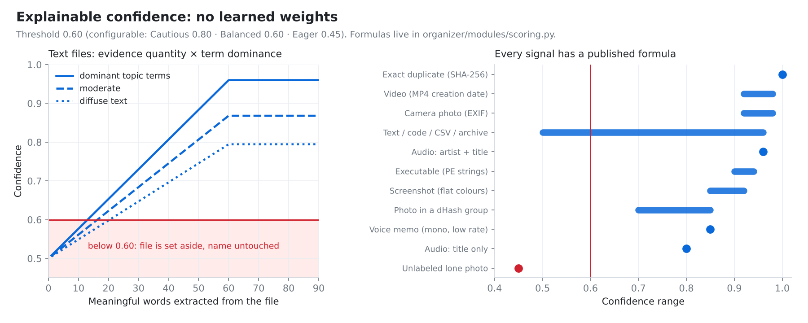

For documents, code, CSV files and archive listings:

```
coverage   = min(1, meaningful_words / 60)                       enough text to judge?
strength   = min(1, share_of_vector_in_top3_terms / 0.10)        do a few terms dominate?
confidence = 0.50 + 0.46 * coverage * (0.6 + 0.4 * strength)
             (minus 0.10 if only single words were available; plus up to 0.04 for a coherent cluster)
```

Other signals use fixed, documented ranges: an exact duplicate is 1.00, a camera photo with EXIF 0.92 to 0.98, a lone photo with no EXIF and no look-alikes 0.45. Everything lives in `organizer/modules/scoring.py`, and every manifest entry stores the numbers that produced it.

### Names are synthesized, but human names are preserved

| Type | Template | Example |
|---|---|---|
| Document, code, CSV | `{date}_{Category}_{Bigram}_{Bigram}` | `2026-11-18_Document_Quarterly-Sales_Revenue-Growth.txt` |
| Camera photo | `{date}_{time}_{W}x{H}` | `2024-05-03_101530_4000x3000.jpg` |
| Screenshot | `{date}_Screenshot_{W}x{H}` | `2026-11-18_Screenshot_1920x1080.png` |
| Audio with tags | `{Artist} - {Title}` | `The Band - Great Song.mp3` |
| Voice memo | `{date}_{time}_VoiceMemo` | `2026-11-18_084608_VoiceMemo.wav` |
| Executable | `{Vendor}_{Product}` | `Acme-Corp_Super-Tool.exe` |

A name is *kept* if it already looks human-chosen. UUIDs, camera prefixes (`IMG_`, `DSC`, `VID_`), generic placeholders (`Untitled`, `copy1`, `track01`, `setup`) and long hex or digit runs are treated as machine names. Names are sanitized for Windows (reserved names, illegal characters, trailing dots), collisions are resolved case-insensitively, and the original extension is always kept.

## Safety model

| Guarantee | Mechanism | Verified by |
|---|---|---|
| Preview changes nothing | Only the manifest is written | `test_preview_changes_nothing` |
| Apply does exactly what was previewed | `apply` executes the manifest, not a fresh analysis | `test_apply_then_rollback_restores_everything` |
| No file is ever overwritten | Destination check at apply time plus a case-insensitive path reserver | `test_apply_never_overwrites` |
| Edited files are not touched blindly | Size is re-checked against the manifest | `test_apply_refuses_when_file_changed_after_preview` |
| Full undo | Reverse-order rollback; empty managed folders removed | end-to-end tests compare a SHA-256 of every file |
| Deterministic | Sorted crawl, alphabetical tie-breaks everywhere | `test_deterministic`, `test_threaded_and_serial_pipelines_agree` |
| Idempotent | Managed folders are never re-crawled; generated names count as clean | `test_idempotent_after_apply` |
| Unattended safety | Software projects, system folders, drive roots and your whole home folder are refused | `TestSafetyRules`, `TestWatching` |
| One bad file never stops a run | Per-file isolation in crawler and extractors | `test_pipeline_survives_corrupt_files` |

## Background service and dashboard

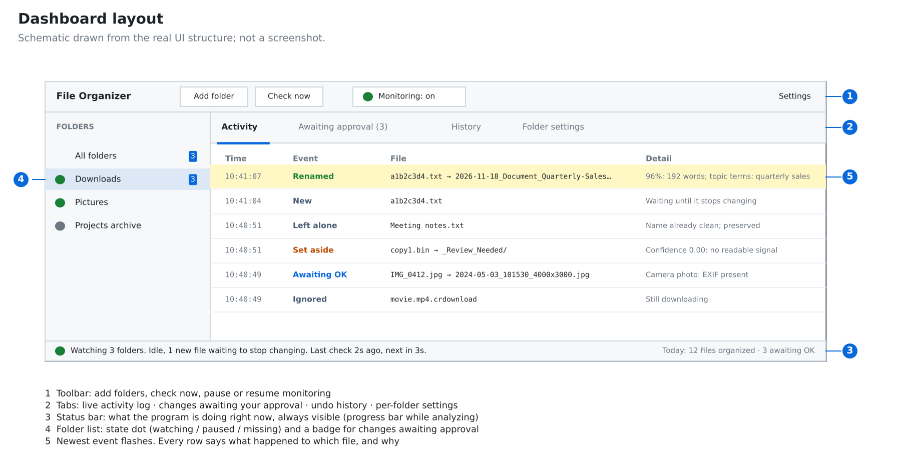

*A schematic of the dashboard structure, not a screenshot; a real capture is a welcome contribution (see [Contributing](#contributing)).*

The service wraps the engine so it can watch folders unattended.

- **Cheap polling.** Each check takes a `{path: (size, mtime)}` snapshot (about 6 ms for 2,400 files) and compares it with memory. Polling was chosen over OS file events because it behaves identically on every platform.
- **The settle rule.** A file is processed only when its size and modification time are unchanged across two consecutive checks, it is at least 3 s old, and it is not a temporary download (`.crdownload`, `.part`, `.tmp`, ...). Half-written files are never touched.
- **Batches.** The engine runs on the *new files only*, using same-size existing files purely as context for duplicate detection. Each batch is an ordinary manifest.
- **Two modes per folder.** *Ask first* lists proposed changes under "Awaiting approval"; *Automatic* applies immediately. Both are undoable from History.
- **Nothing is proposed twice.** A per-folder `seen` list records handled, rejected and undone files, so an undo is respected instead of re-proposed.
- **It explains itself.** A status bar always says what the program is doing (`Analyzing files 14/40: IMG_0042.jpg`, `Idle. Last check 2s ago, next in 3s`), and the activity log gives every file a line: new, awaiting approval, renamed, **left alone (with the reason)**, ignored, duplicate, problem.
- **Always reachable.** A tray icon (click to open, live status, pause, check now, quit) with a small control-window fallback when no tray exists, and single-instance detection so starting the app again just reopens the dashboard.

**The local server is hardened**, because any web page can try to call `localhost`. It binds to `127.0.0.1` only; every API call needs a random per-run token; the `Host` header must be local (blocking DNS rebinding); `POST` must be `application/json`; a strict Content-Security-Policy and `X-Frame-Options: DENY` are set; and file names are inserted as text, never HTML (a test renders a file named ``).

## Benchmarks

Everything below is **reproducible** (`tools/`), and every chart is rendered from `docs/benchmarks/results.json`, never from hand-typed numbers.

**Environment.** One vCPU (Intel Xeon @ 2.30 GHz), Python 3.12.3, Linux, warm file cache, single thread.
**Dataset.** 2,399 files, 94 MB, generated by `tools/make_dataset.py`: 1,729 text-like documents (`.txt .md .csv .py`, 30 topics, 30 exact copies), 240 JPEGs (120 of them 12-megapixel with EXIF), 150 PNG screenshots, 100 MP3, 60 ZIP, 50 WAV, 40 EXE and 30 MP4 files.

### How the work was found

The first version did not finish this folder in 300 seconds. Profiling showed that **93 % of the time was two things**: a clustering algorithm that rescanned every pair after every merge (cubic), and image analysis that decoded each photo at full size and then converted and resized it three times. Everything else (hashing, tokenizing, TF-IDF, scoring) was already under 5 %.

| Change | Effect |
|---|---|
| Heap-based average linkage with sparse k-nearest-neighbour candidates | cubic to near-linear |
| JPEG `draft()` decoding plus one 256 px working copy | up to 30x per photo |
| Read each file once during inspection; `os.scandir` crawler | inspect 3 s to 0.14 s |
| Set-intersection cosine; estimate cluster statistics from 12 members | removes about 50,000 cosines |
| 5 s check interval and a 1.5 s re-check while files settle | reaction time 45 s to 4 s |

### End to end

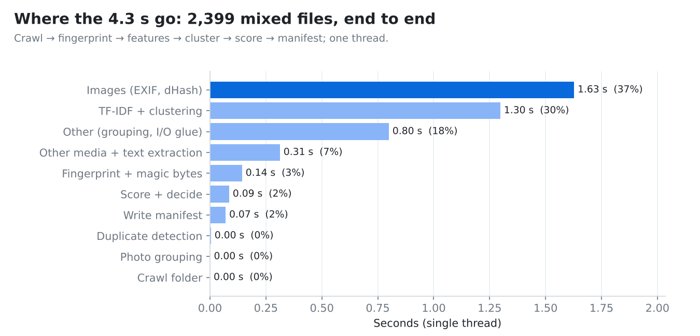

The whole folder takes **4.3 s**: about 37 % in photo decoding (libjpeg and libpng, already native code), 30 % in TF-IDF and clustering, and the rest spread thinly.

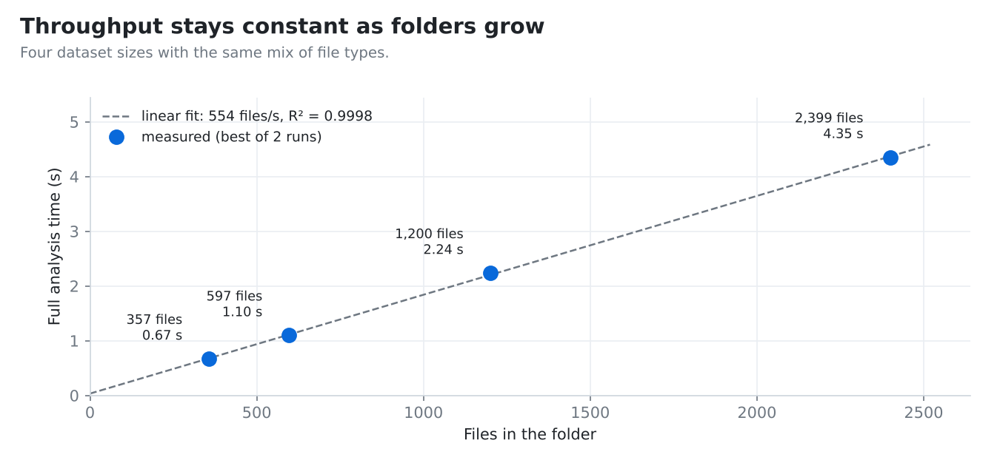

Throughput is flat at roughly **550 files per second** from 357 to 2,399 files (linear fit R² = 0.9998).

### Text clustering

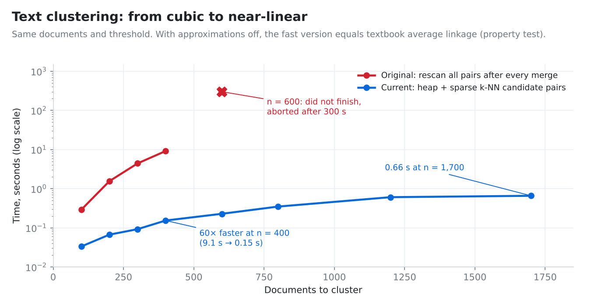

| Documents | Original | Current |
|---|---|---|
| 100 | 0.29 s | 0.033 s |
| 400 | 9.1 s (60x slower) | 0.15 s |
| 600 | **did not finish; aborted after 300 s** | 0.23 s |
| 1,700 | not attempted | 0.66 s |

With every approximation switched off, the fast version returns exactly the same clusters as the textbook algorithm (`test_agglomerative_matches_naive_reference`).

### Image analysis

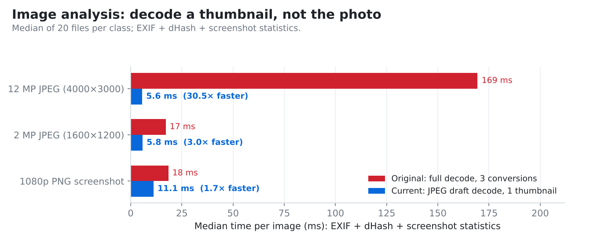

A JPEG can be decoded at 1/2, 1/4 or 1/8 scale directly, so a 12-megapixel photo costs about as much as a thumbnail: **169 ms to 5.6 ms (30x)**. PNGs have no such shortcut (1.7x, from avoiding the repeated conversions).

### Reaction time

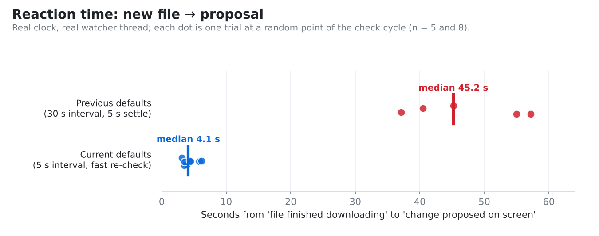

Measured with the real watcher thread and a real clock; each trial writes a file at a random point in the check cycle. The previous defaults (30 s interval, 5 s settle) gave a **median of 45 s** (range 37 to 57 s, n = 5). The current defaults give a **median of 4.1 s** (range 3.2 to 6.2 s, n = 8). Small samples; the gap is large enough that this does not change the conclusion.

### Why there is no C extension

This was tested rather than assumed. After the algorithmic fixes, the hottest pure-Python kernel was the sparse dot product in `cosine()`. A C merge-join over sorted term-id arrays (`tools/native_experiment/`) was **6.9x faster in isolation**, but the data must first be converted into arrays (0.23 s for 900 vectors), and only about 17,000 cosines remain per run. End to end the saving is roughly **3 %**, in exchange for a compiler requirement on every user's machine (MSVC on Windows), per-OS builds, and a second implementation to keep bit-identical. The speed-ups came from algorithms, not the language. Details in [`docs/PERFORMANCE.md`](docs/PERFORMANCE.md).

### Reproduce

```bash
python tools/make_dataset.py /tmp/bench_data                 # 2,399 files (photo synthesis is pure Python: allow a few minutes)
python tools/bench_compare.py pipeline   /tmp/bench_data     # per-stage breakdown
python tools/bench_compare.py clustering /tmp/bench_data     # original vs current clustering (original capped at n = 400)
python tools/bench_compare.py images     /tmp/bench_data     # original vs current image analysis
python tools/bench_compare.py scaling    <dir1> <dir2> ...   # end-to-end throughput on several dataset sizes
python tools/bench_latency.py                                # real-clock reaction time (several minutes)
python tools/make_charts.py                                  # re-render every chart from results.json
```

The original algorithms are preserved in `tools/legacy.py` so the before/after comparison can be re-run by anyone.

## Accuracy evaluation

Speed means little if the answers are wrong, so accuracy is measured against **independent ground truth** (`tools/evaluate.py`).

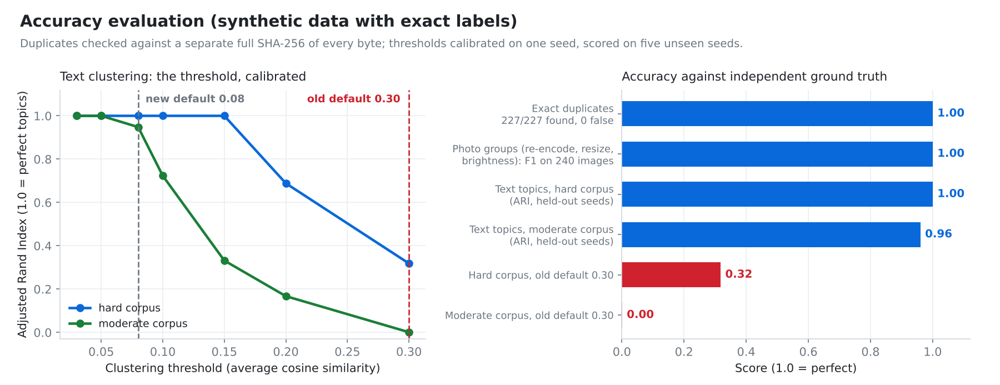

| Task | Ground truth | Result |
|---|---|---|
| Exact duplicates in 2,399 files | A separate SHA-256 of every byte of every file | **227 of 227 found, 0 false positives, 0 false negatives**; only 10.8 % of files needed a full hash |
| Photo grouping | 60 scenes, each as original, JPEG q=30 re-encode, 50 % downscale and +18 % brightness (240 images) | **Precision 1.00, recall 1.00**; every variant recovered |
| Text topics, hard corpus | 30 topics x 20 documents, 168-word vocabulary, overlapping topics | **ARI 1.00** (held-out seeds) |
| Text topics, moderate corpus | 30 topics x 20 documents, 2,000-word vocabulary | **ARI 0.96** (0.95 to 0.98, held-out seeds) |

**A finding worth reporting.** The first evaluation exposed a real weakness. With the original clustering threshold of 0.30, topic recovery was poor (ARI 0.32 and 0.00): perfect precision but almost no recall. The algorithm was sound; the threshold had simply never been calibrated. Sweeping it on one random seed showed a clear plateau, and the new default of **0.08** was then scored on **five unseen seeds** (the numbers above), so the result is not circular. The old default scored 0.32 and 0.00 on the same held-out data.


## Repository layout

```
organizer/
  __main__.py              CLI: ui | daemon | preview | apply | rollback | autostart
  config.py  models.py     every tunable constant; the dataclasses that flow through the pipeline
  modules/                 THE ENGINE
    crawler.py  hasher.py  magic.py  extractors.py
    text_features.py  image_features.py  media_features.py  archive_features.py
    clustering.py  scoring.py  namer.py  decision.py  manifest.py  pipeline.py
  service/                 THE BACKGROUND APP
    service.py             watcher, batches, events, apply / undo
    server.py  static/     hardened local HTTP API and the single-file dashboard
    tray.py  autostart.py  tray icon with fallback window; start at sign-in (Windows / macOS / Linux)
tests/                     96 tests: unit, end-to-end safety, service, server security, UI smoke, tray
tools/                     dataset generator, benchmarks, evaluation, chart and GIF renderers, legacy kernels
docs/                      USER_GUIDE.md  DOCUMENTATION.md  PERFORMANCE.md  assets/  benchmarks/results.json
```

## Testing

```bash
python -m unittest discover -s tests -t .
```

96 tests in about 11 s. They include end-to-end checks that apply and then roll back a messy folder and compare a SHA-256 of every file; a property test that the fast clustering equals the textbook algorithm; a real background-thread watcher test; server security tests (token, Host header, content type, CSP); and a **UI smoke test that runs the dashboard's real JavaScript in Node against a live server**  (it caught two genuine rendering bugs during development). A GitHub Actions workflow (`.github/workflows/tests.yml`) runs the suite on Ubuntu, Windows and macOS.

## Known limitations

- **macOS is not yet verified.** The menu-bar icon, the LaunchAgent autostart and the dashboard on macOS are implemented and unit-tested with stand-in modules, but have not been run on a Mac. Windows has been verified end to end; Linux by automated tests and development runs.
- **The Linux tray depends on the desktop environment.** Some desktops need an AppIndicator extension; the tkinter control-window fallback that covers the remaining cases is tested with fakes only.
- **Polling, not OS file events.** Reaction time is a few seconds, not instant.
- **Some containers are identified but not parsed.** MKV, AVI and WebM get no creation date; RAR and 7z members are not listed.
- **Screenshot detection is a colour-statistics heuristic.** Logos and diagrams without EXIF can be labelled "Screenshot" (this affects the name only).
- **Photo grouping is global** within a batch, not per folder.
- **The multi-core speed-up is untested.** Feature extraction can run in threads (`Pipeline(workers=N)`, proven equal to the serial result), but the benchmark machine had one core.
- **Synthetic evaluation data** (see above).

## Roadmap

- Verify and document macOS behaviour (menu-bar icon, LaunchAgent autostart), and add a real screenshot of the dashboard.
- Optional native file-system notifications (`ReadDirectoryChangesW`, `inotify`, `FSEvents`) behind the same settle rule.
- MKV/WebM header parsing; RAR and 7z listings.
- Optional per-category sorting into folders (today the tool renames and groups; it does not impose a folder taxonomy).

## Contributing

Issues and pull requests are welcome. A few conventions keep the project honest:

- **Determinism is a feature.** No randomness and no dependence on dictionary or file-system order; break ties explicitly.
- **Write the failing test first**, especially for safety behaviour. `TestOrganizeExisting` is a good example of the pattern.
- **Measure before optimizing.** Use `python tools/bench.py <folder> --profile`, and keep `results.json` and the charts reproducible.
- **Screenshots wanted:** a real capture of the dashboard (light and dark) for this README would be a very welcome contribution.

## License

MIT. See [`LICENSE`](LICENSE).

## Documentation

| Document | Audience | Contents |
|---|---|---|
| [`docs/USER_GUIDE.md`](docs/USER_GUIDE.md) | End users | Starting, the tray icon, adding folders, reading the activity log, troubleshooting |
| [`docs/DOCUMENTATION.md`](docs/DOCUMENTATION.md) | Developers and students | Every stage explained (hashing, a worked TF-IDF example, dHash, MP4 atoms, ID3), the service, the API and security model, exercises |
| [`docs/PERFORMANCE.md`](docs/PERFORMANCE.md) | Developers | The profiling investigation in full and the C extension experiment |
| [`docs/MACOS_VERIFICATION.md`](docs/MACOS_VERIFICATION.md) | Mac testers | Step-by-step checklist for the menu-bar icon, LaunchAgent autostart and launcher |
